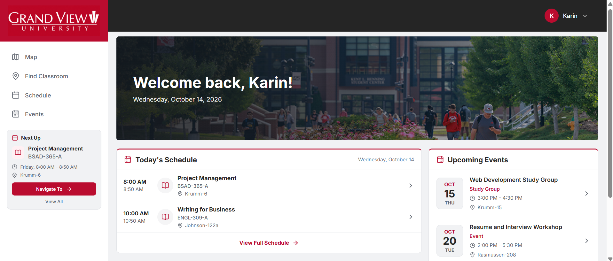
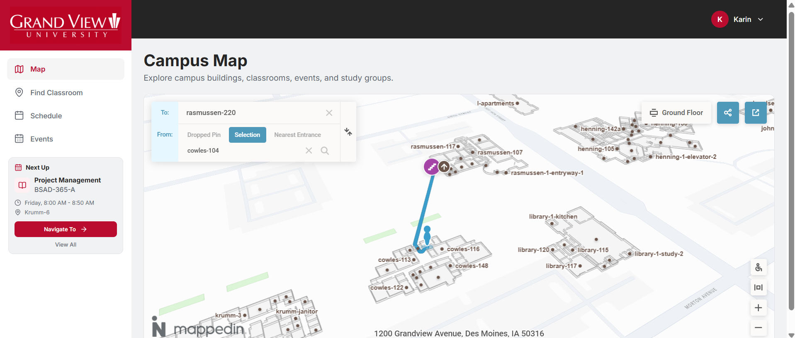
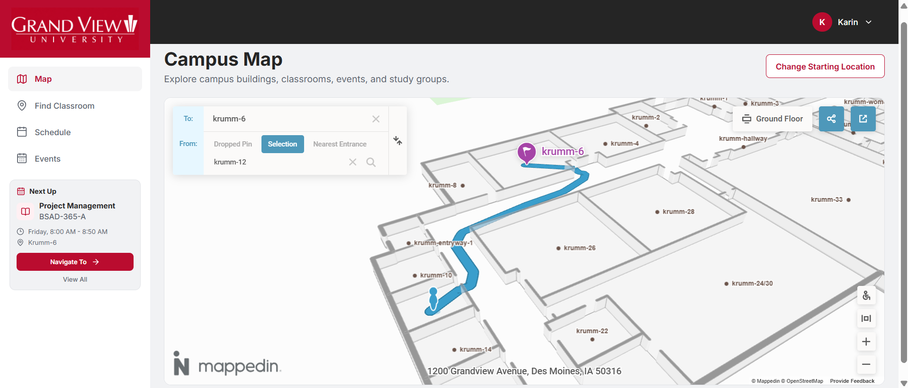
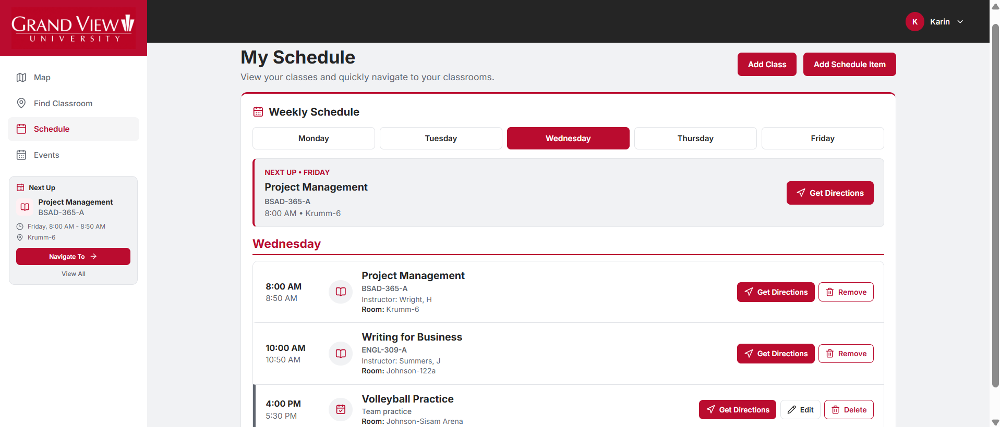
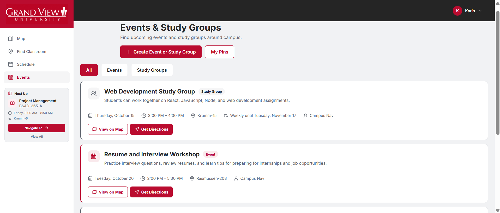

# Campus Nav

Campus Nav is a full-stack web application designed to help Grand View University students navigate campus buildings, locate classrooms, manage their schedules, and discover campus events.

The application combines interactive 3D indoor maps with personalized scheduling and navigation features to make navigating campus easier and more accessible.

## Live Application

Campus Nav is deployed and available online.

**[Launch Campus Nav](https://campus-nav-ruby.vercel.app/)**

The React frontend is hosted on Vercel, while the Node.js and Express backend is hosted on Render. MongoDB Atlas provides cloud database storage.

Users can create an account to explore the campus map, find classrooms, manage schedules, and create campus events.

## Features

### Interactive Campus Navigation
- Interactive 3D campus map powered by Mappedin
- Search for campus buildings and classrooms
- Get directions between locations on campus
- Use your current location as a starting point
- Choose accessible routes to avoid stairs

### Class Schedules
- Add and manage personal class schedules
- Organize classes by day and time
- View upcoming classes and personal schedule items
- Navigate directly to classroom locations
- Save schedules to individual user accounts

### Events and Study Groups
- Create, edit, and delete campus events and study groups
- Place event pins on the campus map
- Create recurring weekly events
- Set events as public or private
- Invite specific users to private events
- Automatically hide expired events and remove them from the database after 30 days

### User Accounts
- User registration and secure login
- JWT-based authentication
- Individual user schedules and events
- Role-based authorization for users and administrators

### Responsive Design
- Desktop and mobile-friendly interface
- Light and dark mode
- Consistent navigation across application pages

## Technologies

| Category | Technologies |
|---|---|
| Frontend | React, JavaScript, SCSS |
| Backend | Node.js, Express.js |
| Database | MongoDB Atlas, Mongoose |
| Authentication | JWT, bcrypt |
| Mapping | MappedIn |
| API Testing | Postman |
| Version Control | Git, GitHub |
| Deployment & Hosting | Vercel, Render |

## Screenshots

The following screenshots showcase the Campus Nav interface and its main features.

### Home Dashboard


### Interactive Campus Map


### Indoor Navigation


### Class Schedule


### Events and Study Groups


## Challenges and Limitations

### Mappedin Free Tier
One of the biggest challenges was working within the limitations of Mappedin's free tier. While it provides interactive 3D maps and indoor navigation, customization options are limited. This affected how directions, map labels, and navigation controls could be displayed.

To work around these restrictions, I developed custom React components that interact with the map while retaining some of Mappedin's built-in functionality.

### Campus Data Integration
Campus Nav does not have direct access to Grand View University's internal systems. As a result, classroom information and sample class data had to be created and managed independently.

I built a MongoDB database and REST API to store and manage this information, allowing the application to function without relying on university system integrations.

### Deployment
Deploying Campus Nav required configuring the frontend and backend as separate services using Vercel and Render. This involved managing environment variables, API connections, database access, and cross-origin requests.

Testing the deployed application helped identify and resolve configuration issues that were not present in the local development environment.

## Future Improvements

Although Campus Nav is fully functional, several improvements could make the application more useful and improve the overall navigation experience.

- **Custom Navigation Interface:** Replace Mappedin's built-in directions panel with a custom interface that provides clearer route information and navigation controls.
- **Step-by-Step Directions:** Provide detailed walking instructions to help users navigate between campus locations.
- **Improved Map Customization:** Expand control over map labels, styling, and navigation features beyond the limitations of Mappedin's free tier.
- **Campus System Integration:** Connect with Grand View University's existing systems to automatically import class schedules and classroom information.
- **Real-Time Campus Updates:** Provide notifications about temporary building closures, construction, and other changes that could affect navigation.
- **Expanded Accessibility Features:** Improve accessible navigation with additional information about elevators, entrances, and accessible pathways.

These improvements would help Campus Nav become a more complete campus navigation solution.

## Running Locally

### Prerequisites

Before running Campus Nav locally, make sure you have:

- Node.js and npm installed
- A MongoDB Atlas database
- Access to the required environment variables

### 1. Clone the Repository

```bash
git clone https://github.com/KarinBrun/campus-nav.git
cd campus-nav
```

### 2. Set Up the Backend

Navigate to the backend directory and install dependencies:

```bash
cd backend
npm install
```

Create a `.env` file in the `backend` directory and configure the required environment variables, including the MongoDB connection string and JWT secret.

Start the backend development server:

```bash
npm run dev
```

### 3. Set Up the Frontend

Open a separate terminal in the root directory of the Campus Nav repository, then run the following commands:

```bash
cd frontend
npm install
```

Configure the frontend environment variables to connect to the local backend API.

Start the frontend development server:

```bash
npm run dev
```

### 4. Open the Application

Open the local URL displayed in the frontend terminal to access Campus Nav.

**Note:** Environment variables must be configured before running the application. Sensitive credentials are not included in this repository.

## Project Background

Campus Nav began as a university project at Grand View University, combining software development and project management.

The goal was to create an application that helps students navigate campus more easily, particularly when locating classrooms in unfamiliar buildings. I wanted to bring indoor navigation, class schedules, and campus events together in one application.

Because the application could not connect directly to university systems, I had to build and manage the classroom and scheduling data independently. The project also required adapting to the limitations of Mappedin's free tier while maintaining a functional and user-friendly experience.

## About the Developer

Campus Nav was developed by **Karin Brun**, a Computer Science student at Grand View University.

Although Campus Nav was originally assigned as a group project, I ultimately took on full responsibility for designing, developing, testing, and deploying the application due to a lack of contributions from the other team members.

My work included:

- Designing and implementing the React frontend
- Developing the Node.js and Express REST API
- Creating and managing the MongoDB database
- Integrating Mappedin for interactive campus navigation
- Implementing authentication, schedules, and event management
- Testing and debugging application functionality
- Configuring deployment with Vercel and Render
- Designing the responsive interface with light and dark modes

**Portfolio:** [karinbrun.name](https://karinbrun.name/)
